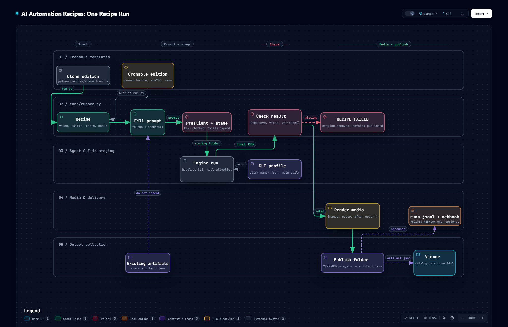

<h1 align="center">🧭 Diagrams</h1>

<p align="center">
  <em>What happens in one recipe run, from the template that starts it to the folder it publishes, drawn from the code and checked against it.</em>
</p>

<p align="center">
  
  
  <a href="../README.md"></a>
</p>

---

## 🔁 One recipe run

[](recipe-run-flow.html)

How a run gets from a Cronsole template to a published folder: the clone edition runs
`recipes/<name>/run.py` from your clone, and the Cronsole edition runs the same file from a pinned,
sha256-checked runtime bundle. `core/runner.py` fills the prompt (reading the collection for the
do-not-repeat list), checks the media keys and stages the skills, then hands a staging folder to the
agent CLI its profile describes. The runner checks the agent's final JSON and files, renders the
media, and only then moves the folder into place with its `artifact.json`, which the viewer reads.
A failed check removes staging and publishes nothing. Below the map, three cards cover failing
closed, the one-profile-per-CLI contract, and the two editions.

**See it on the [homepage](https://ai-automation-recipes.ai-automation-tools.dev/#how)**, or open the interactive version: [`recipe-run-flow.html`](recipe-run-flow.html) in a browser
from a clone, or [render it from GitHub](https://raw.githack.com/ai-automation-tools/ai-automation-recipes/main/docs/diagrams/recipe-run-flow.html).
Each node links to the exact lines it describes at the pinned commit, and the viewer adds route
tracing, search, light/dark, and SVG/PNG export.

## 📂 Files

| File | What it is | Edit it? |
|:---|:---|:---|
| [`recipe-run-flow.json`](recipe-run-flow.json) | The source: lanes, phases, nodes, edges, cards, and the code each node cites | **Yes, this is the only file you edit** |
| `recipe-run-flow.html` · `.png` | Generated: the interactive diagram, which the homepage embeds live, and a static PNG snapshot | Never; rebuild |
| `homepage/diagram/recipe-run-flow.html` · `.png` | Copies the build writes for the homepage, which publishes `homepage/`. `--check` flags a copy that differs | Never; rebuild |
| `recipe-run-flow.delivery.json` · `.sources.lock.json` | Build receipt, and the git blob of every cited file at the pinned commit | Never; rebuild |
| [`../../scripts/build-diagram.mjs`](../../scripts/build-diagram.mjs) | Builds the diagram and checks it for drift | Only to change how it builds or checks |

## 🔁 Keeping it current

Every node cites code by path and line range, pinned to the commit in `meta.repository.revision`.
The cited files are `core/runner.py`, `core/artifacts.py`, `core/deliver.py`,
`core/images/__init__.py`, `core/engines/{__init__,cli}.py`, `cronsole/native-body.py`,
`cronsole/viewer-rebuild.json`, `scripts/build_registry.py`, `scripts/build_viewer.py`, and the
`app-idea-card` recipe as the example of `run.py` and `cronsole.json`. When one changes, the
diagram may describe logic that moved or no longer exists, so it counts as stale until someone has
re-read that code.

| When | What catches it |
|:---|:---|
| **Every push and PR** | CI's *Diagram drift* step runs `--hook` and turns each finding into a warning annotation. It never fails the build |
| **Any time** | `node scripts/build-diagram.mjs --check` exits 1 and names the stale files |
| **Weekly** | The repo owner's doc drift check runs `--check` on the local clone, and the org upkeep job rebuilds a stale diagram by PR |

To bring it up to date:

1. Commit the code change first. Evidence is pinned to committed bytes, never to working-tree edits.
2. Re-read each changed file the check named. In `recipe-run-flow.json`, fix the line ranges in
   `sources` (at most three per node), and any label, sublabel, edge or card the change made
   untrue. A new step in the run loop gets a node in the lane that owns it; a removed one goes.
   Keep the existing ids.
3. Rebuild, re-pinning to the commit you just read:

   ```bash
   node scripts/build-diagram.mjs --pin-head
   ```

4. Commit the JSON, the generated files and the `homepage/diagram/` copies together, with a [CHANGELOG](../CHANGELOG.md) line.

Building needs Node 18+, Chrome, and the [Archify](https://github.com/tt-a1i/archify) skill
(default path `~/.claude/skills/archify/bin/archify.mjs`; pass `--archify <path>` to point
elsewhere). The check needs only git. A failed build exits 1 and leaves the last good HTML and
PNG in place; the reason is in `docs/diagrams/.build/recipe-run-flow.finalize-summary.json`.
None of this is in the runtime bundle, so a diagram change never needs a new `VERSION`.

---

<p align="center">
  <sub>← <a href="../README.md">Documentation home</a> · <a href="../../README.md">AI Automation Recipes</a></sub>
</p>
